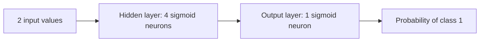

# Checkpoint 03 — Neural Network Architectures

## Objective

Show the structure of a basic feedforward network and specify its layers,
inputs, outputs, and calculations.

## Entropy's first architecture



The network is feedforward: values travel from the inputs through the hidden
layer to the output. The training algorithm later sends information backward
to calculate how to change the weights; that does not change the forward
architecture.

## Shapes and equations

For a batch of `m` examples:

- Inputs `X`: shape `(m, 2)`.
- First-layer weights `W1`: shape `(2, 4)`; bias `b1`: shape `(1, 4)`.
- Hidden values `H`: shape `(m, 4)`.
- Output weights `W2`: shape `(4, 1)`; bias `b2`: shape `(1, 1)`.
- Predicted probabilities `P`: shape `(m, 1)`.

The forward calculation is:

```text
H = sigmoid(X @ W1 + b1)
P = sigmoid(H @ W2 + b2)
```

This 2–4–1 network has 17 learned numbers: 8 first-layer weights, 4 first-
layer biases, 4 output weights, and 1 output bias. The sigmoid output is
interpreted as the probability that the answer is 1.

## Training specification

The current XOR example in `neural_network.py` uses a binary cross-entropy
loss, Xavier-uniform weight initialization, and full-batch gradient descent.
It starts with four labeled input pairs, compares each prediction with the
correct answer, and adjusts all weights and biases after each pass over the
four rows. Checkpoint 04 will record the experiment and its measured results.

## Evidence

This architecture diagram, shape list, and forward specification define the
small feedforward network used for the first training experiment.

## Limitations

This is a small binary classifier for a teaching task. It is not a language
model or a general-purpose assistant.

## Next step

Run and document a reproducible memorization-versus-generalization experiment
in Checkpoint 04.
